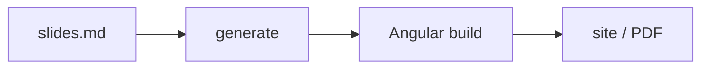

---
# Change the theme here. 'default' is built in; the others are packages (see the Themes slide).
theme: default
title: Welcome to slide.ng
info: |
  ## slide.ng starter
  A tutorial deck. Delete the slides you do not need and write your own.
favicon: /favicon.svg
layout: cover
background: /cover.svg
class: text-center
transition: slide-left
drawings:
  persist: false
duration: 20min
---

# Welcome to slide.ng

Slides in markdown, with Angular templates inside

<div class="mt-12 opacity-80">Press <kbd>Space</kbd> for the next slide</div>

<!--
Speaker notes are the last HTML comment of a slide. Press the presenter button
in the bar (bottom left) to see them next to the slide.
-->

---
transition: fade-out
---

# What is slide.ng?

You write one file, `slides.md`. Each slide becomes an Angular component that is compiled with your app.

<slide-ng-clicks>

- **Markdown first**: write the content, style it later
- **Angular inside**: `{{ }}`, `@if`, `@for` and your own components
- **Developer friendly**: highlighted code, Magic Move, math, diagrams
- **Presentable**: presenter view, notes, drawing, overview
- **Portable**: a static site, a PDF, or a folder that works offline

</slide-ng-clicks>

<!--
Each item above is one click. This note has click markers:

[click] The first item appears.

[click:3] Jump straight to the third click.
-->

---
layout: two-cols
layoutClass: gap-16
level: 2
---

# Table of contents

The table of contents is built from the slides' titles. Use `title` and `level` in a slide's
frontmatter to change how a slide is listed.

```html
<slide-ng-toc minDepth="1" maxDepth="1" />
```

::right::

<slide-ng-toc class="text-sm" minDepth="1" maxDepth="2" />

---
layout: image-right
image: /layouts.svg
---

# Layouts

There are 19 layouts, plus `404` and `error`. Set one in the frontmatter of a slide:

```md
---
layout: image-right
image: /layouts.svg
---
```

`cover`, `center`, `section`, `quote`, `fact`, `two-cols`, `image-left`, `iframe`, `end` and more.
Pictures from `public/` are written with a leading slash.

---
layout: statement
---

# Layouts can carry one idea

`statement` is made for a sentence that deserves the whole slide

---

# Angular in markdown

Template syntax works in the text, with no setup:

```html
Six times seven is {{ 6 * 7 }}

@for (n of [1, 2, 3]; track n) {
<b>{{ n }}</b>
}
```

<div class="mt-6">
Six times seven is <b>{{ 6 * 7 }}</b>, and the loop gives:
</div>

@for (n of [1, 2, 3]; track n) {
<span class="inline-block px-3 py-1 mr-2 rounded bg-purple-500/20">{{ n }}</span>
}

<!--
Block syntax (@if, @for) must be on its own lines. Code fences are never read as Angular.
-->

---

# Clicks

Add `slide-ng-click` to any element:

<div slide-ng-click>This shows up on the first click.</div>
<div slide-ng-click>Then this one.</div>
<div slide-ng-after>And this one shows together with the one before it.</div>

<div slide-ng-click>

Marks are drawn by hand with <span slide-ng-mark.circle.orange="4">`slide-ng-mark`</span>, and
<span slide-ng-mark.underline.red="5">underline</span> works on any inline element:

</div>

```html
<span slide-ng-mark.circle.orange="4">slide-ng-mark</span>
```

---
layout: image-left
image: /layouts.svg
backgroundSize: contain
class: pl-4
---

# Code

Highlights follow the clicks. Each `|` is one step:

```ts [greeter.ts] {1-2|4|6-8|all} {lines:true}
import { Component, signal } from '@angular/core';

const title = signal('Hello');

@Component({
  selector: 'app-hello',
  template: `<h1>{{ title() }}</h1>`,
})
export class Hello {}
```

---
level: 2
---

# Snippets

Show a file, or a region of it, so the code on the slide is the code you test:

```md
<<< @/snippets/greeter.ts#greeter
```

<<< @/snippets/greeter.ts#greeter

---
level: 2
---

# Magic Move

Code morphs between steps. Four backticks and `magic-move` wrap the steps:

````md magic-move {lines: true}
```ts
// step 1: a class with a field
export class Counter {
  count = 0;
  inc() { this.count++; }
}
```

```ts
// step 2: signals
export class Counter {
  count = signal(0);
  inc() { this.count.update((n) => n + 1); }
}
```

```ts
// step 3: a derived value
export class Counter {
  count = signal(0);
  double = computed(() => this.count() * 2);
  inc() { this.count.update((n) => n + 1); }
}
```
````

---

# Math

Inline $\sqrt{3x-1}+(1+x)^2$ and blocks with KaTeX. The block steps with clicks:

$$ {1|2|all}
\begin{aligned}
\nabla \cdot \vec{E} &= \frac{\rho}{\varepsilon_0} \\
\nabla \times \vec{B} &= \mu_0\vec{J} + \mu_0\varepsilon_0\frac{\partial\vec{E}}{\partial t}
\end{aligned}
$$

---

# Diagrams

Mermaid diagrams are written as code:



---

# Your own components

Write an Angular component in `components/`, then use its selector as a tag:

```html
<starter-counter [start]="10" />
```

<starter-counter [start]="10" />

<div class="mt-6 text-sm opacity-70">The code is in <code>components/counter.ts</code>.</div>

<!--
No registry to edit: every exported component with a selector in components/ is imported
into the slides that use its tag.
-->

---

# Icons

Two ways to draw an icon. Iconify sets are tags, styled by the text colour and size:

```html
<carbon-apps /> <mdi-account-circle class="text-red-500 text-3xl" />
```

<div class="mt-4 flex items-center gap-6 text-4xl">
  <carbon-apps /> <mdi-account-circle class="text-red-500" /> <ph-star-fill class="text-amber-500" />
</div>

ng-icons draws inline SVG, with a size, colour and stroke width:

```html
<starter-icon name="lucideRocket" size="48" color="#e5541a" />
```

<div class="mt-4 flex items-center gap-6">
  <starter-icon name="lucideRocket" size="48" color="#e5541a" />
  <starter-icon name="lucideHeart" size="48" color="crimson" strokeWidth="1" />
  <starter-icon name="lucideZap" size="48" />
</div>

<!--
The Iconify tags need no setup: only the icons you use end up in the CSS.
The ng-icons ones are listed in setup/main.ts and wrapped by components/icon.ts.
-->

---
src: ./pages/more-slides.md
---

---
layout: center
class: text-center
---

# Draw on your slides

Click the pen in the bar at the bottom left, or right click and choose drawing.

Draw with the pen, lines, arrows and shapes. Drawings are per slide and follow the presenter.
Set `drawings: { persist: true }` to keep them in `.slide-ng/drawings/` while you run the dev server.

---
class: px-20
---

# Themes

The look of the deck is one line in the headmatter:

<div class="grid grid-cols-2 gap-4 mt-4">

```yaml
---
theme: default
---
```

```yaml
---
theme: seriph
---
```

</div>

The official themes are packages from the slide-ng/themes repository:

```sh
npm i -D @slide-ng/theme-seriph
```

You can also point `theme:` at a folder, or run `npm exec slide-ng theme eject` to copy the current one into `./theme` and edit it.

---

# Export and share

::code-group

```sh [dev]
npm run dev
```

```sh [build]
npm run build
```

```sh [export]
npm run export
```

::

- `build` makes a static site in `dist/`. `netlify.toml`, `vercel.json` and a GitHub Pages workflow are included.
- `export` makes a PDF (needs Chromium). Add `-- --with-clicks` for one page per click.
- `slide-ng build --offline` makes a folder you open from disk with no server, for rooms without Wi-Fi.


> [!TIP]
> Press <kbd>o</kbd> for the overview, <kbd>g</kbd> to go to a slide, <kbd>d</kbd> for dark mode.

---
layout: end
---
